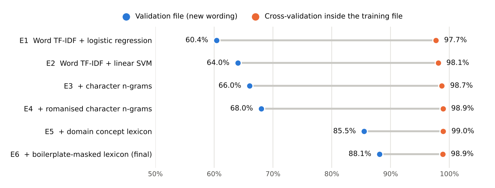
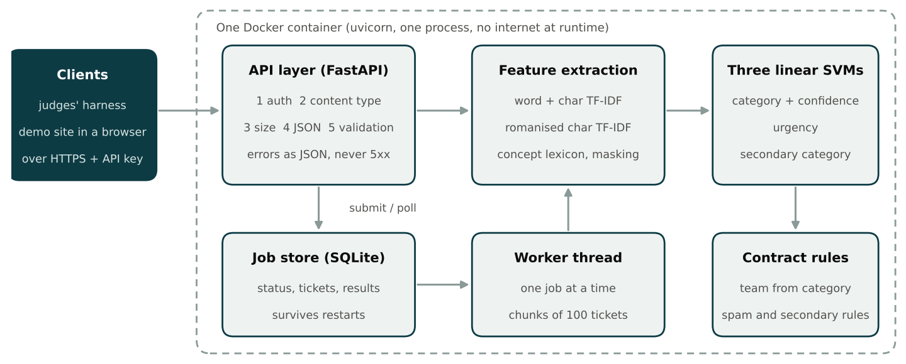

# Data Pulse: Phase 2 MVP report

Team Data Pulse. TensorForge 2.0, IEEE Computer Society KDU. 10 October 2026.

## 1. Problem and constraints

RideEat support receives tickets by chat, email and phone in English, Sinhala, Tamil, Singlish,
Tanglish and mixed script. For each ticket the service must return the primary category (11 classes),
an optional secondary category, the owning team, an urgency flag and a confidence value, through a
fixed API contract that is evaluated automatically. Calling an LLM to do the classification is not
allowed; the container must run offline on 2 vCPU and 4 GB of RAM.

## 2. What the data told us

- 4,000 training and 800 validation tickets. Languages: English 35%, Singlish 25%, Sinhala 20%,
  Tamil 15%, Tanglish 2.5%, mixed 2.5%. 10% urgent, 10% with a secondary category.
- **Tickets are mostly boilerplate.** A typical ticket has four or five filler sentences ("I have kept a
  copy of the confirmation", "mama phone eken baluwe") around one or two sentences that state the issue.
- **Validation is worded differently from training.** We extracted the issue sentences from both files:
  in English, 124 distinct issue sentences occur only in train, 29 only in validation and 10 in both
  (9 of those 10 are spam); Sinhala and Tamil show the same pattern. The validation set therefore measures whether a model
  understands a new way of saying a known problem.
- Consequence: 3-fold cross-validation inside the training file gives about 98% for every model we
  tried, including the weakest baseline. We stopped using it for decisions. All model selection uses
  "fit on train, score on validation".
- `spam_irrelevant` in the data is only nonsense text and bare prompt-injection; classic advertising
  spam never appears.
- The API sends only `channel`, `subject` and `text`. The `language` column is not available at
  inference, so we do not use it as a feature.

## 3. Approach

Three linear SVMs (category, urgency, secondary) share one sparse feature matrix. Each step below was
added because the previous model failed on validation in a specific way.

| # | Model | Val. accuracy | Macro F1 | CV inside train | Why we tried it |
|---|---|---|---|---|---|
| E1 | Word TF-IDF + logistic regression | 60.4% | 0.634 | 97.7% | Baseline |
| E2 | Word TF-IDF + linear SVM | 64.0% | 0.665 | 98.1% | Larger margin, better on sparse text |
| E3 | + character n-grams (2 to 5) | 66.0% | 0.686 | 98.7% | Typos, dropped letters, inflected Sinhala and Tamil words |
| E4 | + romanised character n-grams | 68.0% | 0.703 | 98.9% | Sinhala script and Singlish say the same words in different letters |
| E5 | + domain concept lexicon | 85.5% | 0.853 | 99.0% | New wording uses new words; n-grams cannot know that "reimbursement" means "refund" |
| E6 | + boilerplate-masked lexicon | 88.1% | 0.878 | 98.9% | Filler sentences were triggering lexicon concepts by accident |

{width=16.5cm}

**Romanisation (E4).** `app/romanize.py` maps Sinhala and Tamil letters to Latin and drops vowel length,
so `සල්ලි කැපිලා` becomes `salli kapila`, exactly what a Singlish writer types. Sinhala accuracy rose
from 47% to 57%, with other languages moving by a point or two either way.

**Concept lexicon (E5).** `app/lexicon.py` defines 37 concepts (refund, charge, delay, missing item, lost
belongings, threat, dangerous driving, app failure, login, promo, urgency cues and so on). Each has keyword
stems for English, romanised Sinhala/Singlish and romanised Tamil/Tanglish, written from domain knowledge.
The lexicon only reports that a concept is present; the SVM learns what each concept means for each
label. This is the step that addresses the wording shift: English went from 56% to 81%, Sinhala from 57%
to 81%, Tamil from 65% to 83%.

**Boilerplate masking (E6).** A word trigram that appears in at least six tickets across at least five
categories cannot be about one category, so it is treated as filler. 3,138 such trigrams are learned from
the data and masked before the lexicon is applied a second time. English rose from 81% to 88%.

**Ideas we tested and rejected**

| Idea | Result on validation | Decision |
|---|---|---|
| Averaged pretrained English word vectors (300-d) as extra features | +1.4 points | Rejected: 160 MB of vectors for a gain inside the noise |
| Synonym augmentation of training tickets using those vectors | +0.8 to +1.3 points | Rejected: not reliable across settings |
| Removing boilerplate from the TF-IDF input itself | 65.5% down to 58.5% | Rejected: train then looks unlike test, which still contains unknown filler |
| Adding noisy copies (random character drops) of training tickets | 87.9% down to 87.0% on clean text, +1 point on noisy text | Rejected: costs as much as it gains |

**Other heads and tuning (all on validation, model fitted on train only)**

- Urgency: binary SVM with balanced class weights, threshold chosen for best F1.
- Secondary category: SVM over "none" plus the categories; the best class other than the primary is
  returned only if it beats "none" by a tuned margin.
- Confidence: softmax of the category margins divided by a temperature fitted by minimising log-loss.
- Spam: 30 hand-written advertising and phishing examples were added to training, since the data has none.

The shipped model `datapulse-1.0.0` is this recipe refitted on train + validation (4,830 tickets with the
spam examples), 49,527 features, 4.2 MB.

## 4. Evaluation

Fitted on train only, scored on the 800 validation tickets:

| Output | Result |
|---|---|
| Category | accuracy 88.0%, macro F1 0.876, weighted F1 0.879 |
| Urgency | precision 0.936, recall 0.913, F1 0.924 (80 urgent tickets) |
| Secondary category | exact-label precision 0.931, recall 0.838, F1 0.882; whole field correct on 98.1% of tickets |
| Confidence | expected calibration error 0.594 uncalibrated, 0.034 after temperature scaling |

By language: Singlish 98.0%, English 87.9%, Sinhala 85.0%, Tamil 81.7%, mixed 80.0%, Tanglish 60.0%
(only 20 tickets). By channel: call transcript 93.0%, chat 86.9%, email 85.4%.

Weakest categories: missing or wrong order (F1 0.78), general question (0.79), lost item (0.81, recall
0.68, mostly confused with ride issues), app problem (0.81, recall 0.70, confused with missing or wrong order).

Human review: tickets with confidence below 0.60 get `needs_human_review: true`. That sends 13% of
tickets to a person; the other 87% are routed automatically at 95.7% accuracy, while the flagged group is
only 38% accurate.

Robustness probe: deleting 4% of characters and all sentence punctuation from validation text lowers
category accuracy from 88.0% to 77.5%.

Service checks: 58 automated contract tests validate every response against the organisers' JSON
Schemas (auth, error codes and their order, batch atomicity, paging, idempotency, queue limit, restart
handling, expiry). On 2 vCPU: `/predict` p95 10 ms, 100-ticket batch 0.2 s, 5,000-ticket job 12 s, 230 MB RAM.

## 5. System design

{width=16.5cm}

- **One container, one process.** FastAPI on uvicorn. The model loads in a background thread, so
  `/health` answers 503 until it is ready and 200 afterwards (about 2 seconds).
- **Hand-written request handling.** Bodies are read and validated manually so that the order
  auth, content type, size, JSON, validation is exact and errors carry `index`, `field`, `issue`.
  Error responses are sent only after the request body has been read, otherwise clients see a connection
  reset instead of the 401 or 413.
- **Jobs.** SQLite holds job state and results; a single worker thread classifies in chunks of 100, so
  `/health` and `/predict` stay responsive. Jobs running at a restart become `failed / interrupted`;
  queued jobs resume. Capacity 1 running + 3 queued, then 429. Results are kept 24 hours, then 410.
- **Consistency in one place.** `app/model.py` derives `team` from `category` and applies the spam and
  secondary rules for every endpoint, so sync and async answers are identical.
- **Demo site.** A single static page served by the same container: route one ticket (with the three
  closest categories and matched concepts), route a file as a background job, and a results dashboard.

## 6. Findings, limitations and next steps

1. **In-distribution scores are misleading on this data.** Every model scores 98% inside train; the
   baseline drops to 60% on new wording. Teams that select models by cross-validation will overestimate.
2. **Knowledge, not capacity, was the bottleneck.** Feature engineering that adds meaning (shared script,
   concept lexicon) gave +24 points; classifier and n-gram tuning gave +6.
3. **Our 88% is optimistic.** The lexicon was refined after reading English validation errors. On a test
   set with a third set of wordings we expect a result between E4 (68%) and E6 (88%), and the shipped
   model, which has also seen the validation wordings, should sit toward the upper end.
4. **Typos hurt** (88% to 78% under heavy noise), because lexicon keywords must match.
5. **Short tickets without boilerplate are weaker.** On the five example requests in the API
   specification the shipped model gets four primary categories right, but it misses one urgency flag
   (by a narrow margin) and both secondary categories.
6. **Tanglish and mixed script** have 20 validation tickets each; their numbers are not reliable.
7. **The lexicon needs maintenance.** A new product area means new keywords.

Next: fine-tune a small multilingual encoder (for example XLM-R or multilingual MiniLM) and combine it
with these features, which should replace most of the lexicon; add fuzzy keyword matching for typos;
store jobs on a persistent volume in production.
